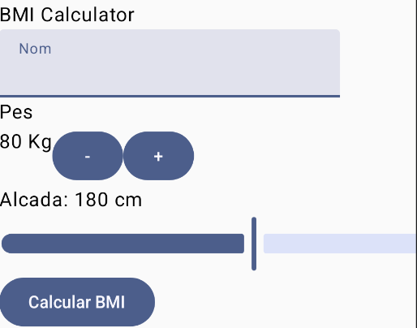
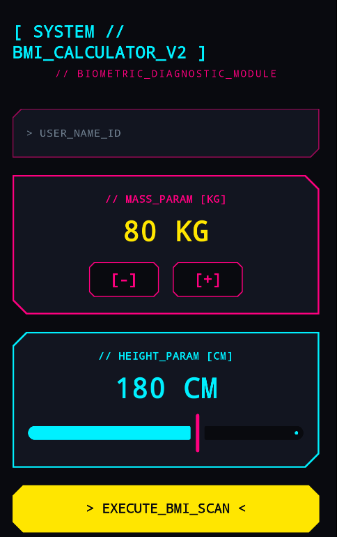

# BMI Calculator Jetpack Compose

Una aplicació Android desenvolupada amb **Jetpack Compose** per a calcular l'Índex de Massa Corporal (BMI / IMC). Aquest projecte mostra com es pot evolucionar una interfície d'usuari (UI) senzilla cap a un disseny modern, interactiu i totalment personalitzat.

---

## 📱 Exemples de la Interfície d'Usuari (UI)

A continuació es mostren els dos estils de la UI creades en el projecte:

| Interfície Material 3 | Interfície Cyberpunk |
| :---: | :---: |
|  |  |

## 🌿 Branques del Projecte (Branches)

El repositori compta amb dues branques on s'han realitzat les modificacions de la UI:

- **`master`**: Conté la versió inicial i funcional de la calculadora de BMI amb la interfície bàsica.
- **`UI-bonica`**: Branca on s'han desenvolupat i aplicat les millores de disseny visual (la versió Material 3 i el redisseny Cyberpunk).

---

## 🛠️ Tecnologies Utilitzades

- **Kotlin**
- **Jetpack Compose** (Material 3, State Management, Custom Shapes & Styling)
- **Android Studio / Gradle**
